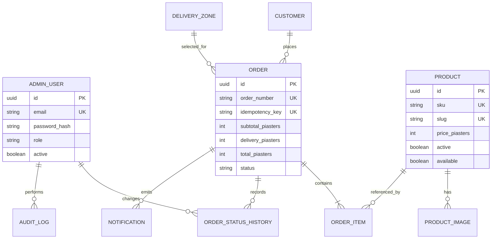
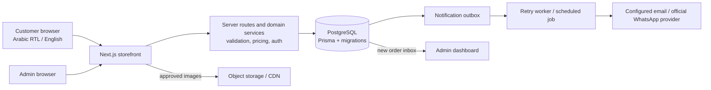

# El Mohandeseen Olive Oil — Phase 1 PRD

**Status:** Discovery draft for owner review  
**Phase:** 1 — Discovery and Product Requirements  
**Decision gate:** Owner approval is required before Phase 2 (UX and detailed architecture).

## 1. Evidence reviewed and limits

- Reviewed the supplied project brief in full.
- The referenced Facebook share URL could not be fetched in this review. Public search did not identify a clearly attributable page for this business, so no business details have been verified from Facebook.
- The supplied attachment folder contains only the text brief. No logo, product photographs, screenshots, or other brand assets were available. The workspace contains no starter project files.
- The prices and packaging below are taken from the brief. They are the required initial catalog values, but the owner should reconfirm that they remain current before the store is published.
- No business phone number, address, delivery policy, operating hours, inventory data, or integration credentials were supplied. None should be invented or shown as live business information.

The project folder is empty. Node.js 24.18.0, npm 11.16.0 (via `npm.cmd`), and Git 2.55.0 are available. The PowerShell `npm` shim is blocked by the machine execution policy; `npm.cmd` works. PostgreSQL, hosting, and external service availability have not been established.

## 2. Business understanding

El Mohandeseen Olive Oil is an Egyptian olive oil seller that wants to move orders from social and direct channels into a dependable online storefront. The intended customer is primarily Arabic-speaking and in Cairo/Giza. Customers should be able to order as guests, receive a clear total before submitting, and pay cash on delivery if the owner enables that option. The owner needs to update products, prices, delivery settings, and order statuses without developer help.

The store must preserve the actual brand and product appearance. Arabic is the default, the experience is RTL, and English is a secondary option. The product catalog described in the brief has three capacities, all in plastic packaging. The site must not make unsupported claims about origin, grade, production, health, certifications, reviews, delivery, or quality.

### Initial catalog facts from the brief

| Catalog item | Capacity | Packaging | Seed price |
|---|---:|---|---:|
| Olive Oil — زيت زيتون | 1 liter | Dark plastic bottle | EGP 550 |
| Olive Oil — زيت زيتون | 500 ml | Dark plastic bottle | EGP 275 |
| Olive Oil — زيت زيتون | 12 liters | Jerrycan | EGP 6,100 |

Availability, stock counts, detailed product copy, product origin/grade, and images are not confirmed. Prices must be stored in the database and read dynamically; the values above must not be duplicated as frontend constants.

## 3. Product requirements document

### Goals

1. Let a customer browse the three products, compare capacities and prices, and submit a guest order on mobile or desktop.
2. Calculate totals on the server using the current database prices and configured delivery rules.
3. Persist complete orders with unique references and price snapshots.
4. Give an authenticated administrator a usable way to see new orders, contact customers, manage statuses, products, prices, and delivery settings.
5. Launch with truthful Arabic-first content, correct RTL, accessible controls, and real brand/product assets.

### Success criteria for launch

- A customer can complete the browse-to-confirmation flow without an account.
- The order, order items, status history, calculated delivery fee, and amount due are stored consistently in PostgreSQL.
- Repricing a product in the admin changes the next server-rendered/API price without a code change; previous orders retain their original price snapshots.
- The owner can find an order by its reference, customer name, or phone and update its status.
- Order visibility in the admin works even if email/WhatsApp delivery is unavailable.
- Arabic RTL works across store, cart, checkout, and admin on supported mobile/tablet/desktop widths; no unsupported claims or fabricated reviews appear.
- Production launch additionally requires owner decisions, approved business copy/assets, operational configuration, and successful security/quality/deployment verification in later phases.

### Out of scope for initial release

- Customer accounts, loyalty points, subscriptions, recurring orders, and personalized marketing.
- Online card/wallet payments until provider credentials and explicit activation approval exist.
- Multi-vendor, multi-currency, international shipping, and automated courier integrations.
- Product reviews/testimonials until genuine, permissioned submissions are available.
- Automatic stock deduction unless the owner confirms inventory tracking rules.

## 4. Functional requirements

### Storefront and catalog

- **FR-01:** Serve Arabic as the default locale with full RTL and an English language switch. Keep language and direction correct on every route and at mobile sizes.
- **FR-02:** Show the business identity and three products with database-sourced names, capacity, packaging, price, image, availability, and approved descriptions.
- **FR-03:** Provide a product listing and an individual detail URL for each product. Let the customer choose a valid quantity and add it to cart or start checkout.
- **FR-04:** Use supplied, owner-approved imagery only. Do not create or show glass packaging as an available product.
- **FR-05:** Build homepage sections for featured products, verified brand/product information, ordering steps, delivery information, FAQs, contact, and social links. Hide reviews until real reviews are supplied and approved. Do not show delivery promises until the current policy is confirmed.
- **FR-06:** Provide semantic, keyboard-accessible navigation, cart access, clear error/success messages, and localized EGP formatting.

### Cart, checkout, and orders

- **FR-07:** Persist a guest cart across refreshes on the same browser. Store product identifiers and quantities client-side; the server remains authoritative for product status, prices, fees, and totals.
- **FR-08:** Support quantity changes and item removal. Reject zero, negative, fractional, excessive, missing, or unavailable product quantities on the server.
- **FR-09:** Collect customer full name, mobile, governorate/city, area, full address, building number, optional apartment/floor, nearby landmark, optional notes, and preferred contact method if the owner chooses to support it.
- **FR-10:** Before confirmation, show products, quantities, unit-price snapshots, subtotal, delivery fee, any enabled discount, and final total.
- **FR-11:** On submit, validate inputs and re-fetch current product prices/availability and delivery rules on the server. Never trust prices or totals sent by the browser.
- **FR-12:** Create an order number and persist the order, immutable line-item price/name/packaging snapshots, delivery-fee/zone snapshot, initial status and status history atomically. Use a unique idempotency key to prevent accidental duplicate submissions.
- **FR-13:** Show a confirmation page with the order reference and amount due. Do not expose another customer's order via a guessable order number; confirmation access should use a separate unguessable token or protected session.
- **FR-14:** Support COD only when enabled by an administrator. Keep the payment model extensible, but do not enable a gateway without credentials and approval.
- **FR-15:** Persist a notification event with the order. Admin dashboard visibility is the reliable baseline. If external channels are later configured, deliver through an official WhatsApp Business API provider and/or approved email service with retries and error logging; notification failure must not roll back the order.

### Administration

- **FR-16:** Protect all admin routes and mutations with secure authentication, server-side authorization, and secure session cookies. No public admin registration.
- **FR-17:** Show order counts by status, total sales using a documented rule, recent orders, and a searchable/filterable order list.
- **FR-18:** Allow viewing full order/customer/address details, internal notes, WhatsApp contact links when configured, and status changes through NEW → CONFIRMED → PROCESSING → SHIPPED → DELIVERED, with CANCELLED as an allowed terminal state. Record actor and timestamp for every change.
- **FR-19:** Allow administrators to create, edit, activate/deactivate products, update bilingual content, price, packaging, images, and availability. Preserve products referenced by orders (deactivate/archive rather than destructive delete).
- **FR-20:** Allow delivery zones/areas, fees, availability, free delivery, and optional minimum order amount to be configured. No zone should be promised until its details are entered and approved.
- **FR-21:** Allow business settings such as display name, logo, phone/WhatsApp, social URLs, address, hours, and delivery policy to be edited. Never display missing settings as fabricated values.
- **FR-22:** Record sensitive admin actions, including product-price and delivery-rule changes, in an audit log.

## 5. Non-functional requirements

- **Security:** Validate all input server-side; use parameterized ORM access; escape/render content safely; protect state-changing admin requests against CSRF where applicable; hash passwords with a modern password hash; rate-limit login and order submission; use secure, HTTP-only, SameSite cookies; enforce authorization on the server; validate uploaded file type, size, and content; keep secrets server-side; return generic public errors and detailed redacted logs.
- **Integrity:** Use database transactions for order creation and status changes where appropriate. Store money as integer piastres (or an exact decimal type), never floating-point. Recalculate totals from database prices and delivery configuration. Add unique constraints for order number and idempotency key.
- **Privacy:** Collect only what is required for fulfillment. Define access, retention/deletion, privacy notice, consent for any marketing use, and backup retention before launch. Do not send customer details to external services unless configured and approved.
- **Reliability:** An external notification outage must not prevent an order from being saved. Use durable notification/outbox records, bounded retries, and visible failure state. Back up the database and document restore steps before production.
- **Performance:** Mobile-first layout, optimized responsive images, lazy-load below-the-fold imagery, cache public catalog data safely, and keep checkout/order/admin data fresh. Establish measured performance budgets in Phase 2 based on the chosen hosting and assets.
- **Accessibility:** Target WCAG 2.2 AA for contrast, labels, focus, keyboard use, status announcements, and touch targets. Verify both RTL and LTR.
- **SEO:** Arabic metadata, canonical and locale URLs, Open Graph preview using approved logo/product imagery, sitemap, robots rules, semantic HTML, and accurate Product/Offer structured data. Publish only current database prices and valid availability.
- **Maintainability:** TypeScript, reusable components, clear domain/service boundaries, migrations, documented environment variables and admin initialization. No secrets or production data in source control.
- **Operations:** Add structured error logging, monitoring/alerts, scheduled backup guidance, and a documented deploy/rollback/migration procedure. No claim of deployment until a production URL and order flow are verified.

## 6. Customer journeys

### Browse and place an order

1. Arrive from search or a social link on the Arabic RTL homepage.
2. Browse the catalog and compare 500 ml, 1 L, and 12 L options, their approved packaging photos, availability, and current prices.
3. Open a product detail page, choose a quantity, and add it to cart or choose “Buy now.”
4. Review/edit the cart. Prices are refreshed from the server; delivery is shown only after the customer selects a supported area.
5. Enter contact and delivery details as a guest; select COD only if enabled.
6. Review the full server-calculated order summary and submit once.
7. Receive a confirmation and private order reference. The order is visible to the administrator even if external notification delivery fails.

### Follow up

1. Customer contacts the business via the approved phone/WhatsApp details or uses the order reference when contacting support.
2. Admin finds the order, checks its status/history and delivery notes, then updates it as fulfillment progresses.
3. Any customer-facing status messages are sent only through configured, approved channels.

## 7. Admin journeys

### Daily order operations

1. Admin signs in through a protected route.
2. Dashboard highlights new/pending orders and recent activity.
3. Admin searches or filters, opens an order, checks the saved contact/address and line-item snapshots, and confirms it.
4. Admin uses a configured contact channel if needed, adds internal notes, and advances status through processing, shipped, and delivered (or cancels with a recorded reason/note).
5. Status history shows who changed what and when.

### Routine store management

1. Admin edits a product price/content/availability or archives a product; the storefront reflects the change without a code deployment.
2. Admin updates delivery zones and fees or toggles COD/free delivery/minimum order settings.
3. Admin edits verified contact, social, and operating information.
4. Audit history records price, delivery, and important settings changes.

## 8. User stories and acceptance criteria

| User story | Acceptance criteria |
|---|---|
| As a shopper, I want to compare sizes and prices so I can choose the right package. | All active products show capacity, plastic packaging type, current EGP price and availability; each has its own detail URL and approved photo. |
| As a shopper, I want to order without an account. | Required delivery/contact fields are validated; optional fields remain optional; a valid order yields a reference and confirmation. |
| As a shopper, I want a trustworthy total. | Review shows line totals, subtotal, configured fee/discount and final total; changing a client-side price does not affect the stored total. |
| As a shopper, I want to avoid submitting twice. | Repeated submission with the same idempotency token creates one order and returns the same safe confirmation. |
| As an admin, I want to update prices without a developer. | An authorized price edit is stored in the database, appears in the next catalog/quote response, and does not alter existing order snapshots. |
| As an admin, I want to process and search orders. | Search by order number, customer name, and phone; filter by date/status; changes create timestamped history entries. |
| As an admin, I want to configure delivery and COD. | Zone, fee, availability, free delivery, minimum amount, and COD controls affect server calculations only after being saved. |
| As an owner, I want orders to remain visible if messaging fails. | Order transaction commits independently; an admin-visible notification exists; external failures are logged and retryable. |

## 9. MVP and later enhancements

### MVP for the first real launch

- Arabic-default RTL storefront, English customer language option, home/catalog/detail/cart/checkout/confirmation pages.
- Three database-backed product records with the brief's seed prices and plastic packaging; approved photographs and descriptions are launch prerequisites.
- Guest cart and checkout, server-calculated totals, order snapshots, order number, idempotency protection, COD toggle, configurable delivery zones/fees.
- Secure admin sign-in, dashboard, order search/detail/status/history/notes, product and price management, availability management, delivery and store settings, audit log.
- Durable in-dashboard new-order notification. Email/WhatsApp adapters can be enabled after provider and credentials are approved; no live external integration is assumed.
- Arabic/English SEO metadata, accessibility, privacy/delivery/terms content, logging, backups and deployment documentation.

### Later or contingent

- Inventory quantities and automatic stock reservation/deduction if the owner defines stock rules.
- Official WhatsApp Business API/email delivery, templates, delivery receipts, retry worker and alerting once accounts/credentials/recipients are supplied.
- Online payment integration only after explicit approval and provider credentials.
- Genuine reviews with consent, discount campaigns after rules are approved, courier integrations, customer accounts, order tracking portal, analytics, advanced roles, multiple branches/currencies.

## 10. Proposed data entities and relationships

The initial model treats each capacity/package combination as a sellable **Product/SKU**. This keeps price and availability independently manageable for the 500 ml, 1 L, and 12 L items. Product deletion should be restricted once referenced; use active/available flags instead.

| Entity | Purpose and key fields |
|---|---|
| **AdminUser** | Admin identity, password hash, role, active flag, timestamps. No public self-registration. |
| **Customer** | Guest contact record created at checkout: name, normalized phone, optional email. Avoid cross-customer deduplication based only on phone. |
| **Product** | SKU, slug, Arabic/English name and description, volume/unit, packaging, current price in piastres, active/available flags, optional inventory setting, timestamps. |
| **ProductImage** | Product FK, storage key, localized alt text, sort order, primary-image flag. |
| **DeliveryZone** | City/governorate and area, enabled flag, fee, optional free-delivery threshold/constraints, timestamps. Rules need owner confirmation. |
| **StoreSettings** | Singleton/configuration for display identity, contact/social details, currency (initially EGP), COD toggle, hours, and delivery policy. Secrets remain in environment/secret storage. |
| **Order** | Unique order number and idempotency key; customer FK plus immutable name/phone/address snapshot; zone FK plus zone/fee snapshot; subtotal, discount, delivery, total; payment method/status; order status; notes; timestamps. |
| **OrderItem** | Order FK, optional Product FK, SKU/name/capacity/packaging/price snapshots, quantity, line total. Historical rows remain valid if product changes. |
| **OrderStatusHistory** | Order FK, previous/new status, timestamp, optional AdminUser actor, note/reason. |
| **Notification** | Order FK, channel/type, queued/sent/failed status, attempt count, next-attempt time, redacted error/provider reference, timestamps; supports dashboard inbox and external outbox. |
| **AuditLog** | Admin actor, action/entity/id, redacted before/after values as appropriate, timestamp and request metadata. Avoid logging secrets or unnecessary customer data. |

### Relationship sketch

Order creation should be one database transaction: validate products and delivery rules, compute exact totals from current records, create customer/order/item snapshots, create initial status history, and enqueue an admin notification. Index order number, creation date, status, customer phone/name, product slug/SKU, and notification retry state. Use foreign keys and restrictive product deletion; use soft deactivation for catalog removals.

## 11. Initial system architecture

### Recommended direction

- **Web/app:** Next.js App Router, React, TypeScript, Tailwind CSS, reusable accessible RTL-aware components.
- **Server:** Next.js Route Handlers/server-side application services for catalog quotes, checkout, and admin operations. Keep pricing/order rules in server domain services, not client components.
- **Database:** Managed PostgreSQL with Prisma ORM and checked-in migrations. PostgreSQL is the source of truth for products, orders, delivery settings, admin access, and notification state.
- **Authentication:** Private admin accounts, role checks, strong password hashing, secure cookie-backed sessions, rate limiting, and audited mutations. No customer account requirement.
- **Images:** Object storage/CDN for approved original logo/product images; database stores object key and metadata. Validate uploads and keep image delivery optimized.
- **Notifications:** Transactional outbox/notification rows; dashboard inbox is the baseline. A worker/scheduled process sends configured external notifications and retries failures without blocking checkout.
- **Hosting:** One Next.js application, managed PostgreSQL, object storage, and a scheduled worker/job. Select exact vendors and region in Phase 2 after account, budget, privacy, and deployment constraints are known.

The user journey depends on PostgreSQL and application hosting being configured. External messaging is an optional delivery channel, not an order persistence dependency.

## 12. Decisions and information needed from the owner

These are the material open items before production copy/configuration. They can be answered after reviewing this PRD; no assumptions should be published as fact.

### Brand, product, and content

1. Please provide the logo, original photos for each plastic package, packaging/label screenshots, and any Facebook post screenshots you want used. Are these current and approved for web use?
2. Confirm the public Arabic/English business name and whether the supplied suggested headline is approved.
3. Confirm that the listed prices (EGP 550 / 275 / 6,100) are current launch prices and whether tax is included.
4. For each product, confirm availability, SKU (if any), permitted product description, origin, grade, ingredients, storage/shelf-life wording, and any label-required disclosures. Only verified facts will be published.
5. Should inventory be only an available/unavailable switch at launch, or should the admin track stock quantities and reserve stock at checkout?
6. Provide real customer reviews only if you want a testimonials section; include permission to publish names/photos. Otherwise that section stays hidden.

### Delivery, payment, and customer support

7. Which governorates/cities/areas will be served at launch? What are the fees, delivery estimates, exclusions, free-delivery rules, and minimum order amount for each? Is the historical New Cairo free-delivery offer still valid?
8. Is COD enabled at launch? Any order limits, deposit rules, or cancellation/refusal policy?
9. Provide business phone and WhatsApp numbers, preferred contact channel, support hours, business address (if public), email, and any official Facebook/Instagram URLs.
10. Who receives new-order notifications? Which official WhatsApp Business API provider/account or email service should be used, and can the required credentials/templates be configured? Until then, will checking the admin dashboard be an acceptable order alert process?

### Operations, policy, and launch

11. Who will be the initial administrator, and should later staff have separate roles (owner/manager/fulfillment)? Provide no password in chat; use a secure initialization flow during deployment.
12. What are the return/refund, damaged-product, cancellation, privacy, and customer-data retention policies? Who approves the Arabic/English legal text?
13. Which hosting/domain accounts, budget, preferred deployment region, and database/image storage services are available? Does the business already own a domain?
14. Is online payment explicitly out of launch scope (recommended until a provider and credentials are approved)?
15. Do you approve proceeding to Phase 2 using this product/guest-checkout/admin scope, with the unanswered operational rules shown as configurable but unpublished until decided?

## 13. Phase 1 exit and next gate

Phase 1 is complete as a discovery draft. Phase 2 should begin after you approve this PRD and answer the launch-critical questions (at minimum: asset availability, current prices, delivery coverage/fees, COD, business contact/notification route, inventory approach, and policy owner). Phase 2 will turn this proposal into the detailed sitemap, responsive wireframes/design system, final schema/migrations plan, and deployment choice. No application code or deployment work has started.
